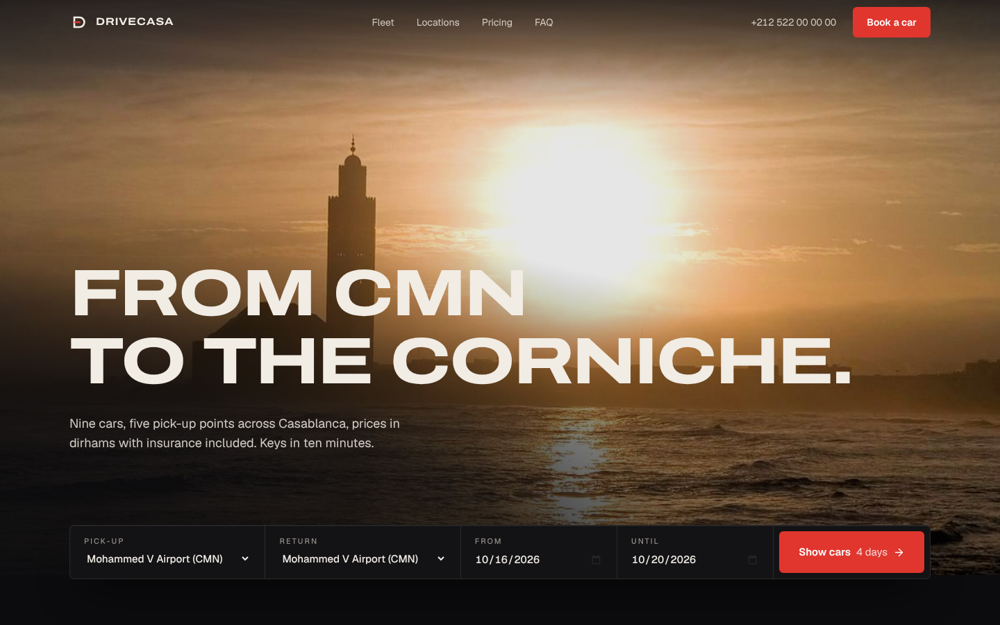
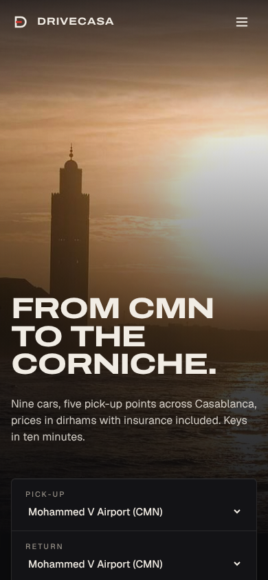

# DriveCasa: Car Rental in Casablanca

> A car rental site for Casablanca, designed like a real product: full-bleed city photography, a dark editorial layout with one action red, and a booking flow that shows the full price up front in dirhams.



<p align="center"></p>

## What's in it

- **Hero**: a full-bleed photo of the Hassan II Mosque at sunset that scales up as you scroll, a two-line headline over a corner scrim, and the trip search form overlapping the bottom edge of the photo.
- **Fleet**: nine cars, each with a real photo cropped to the same 16:10 frame (focal point set per car). Filter by type with an animated `layoutId` tab, by gearbox and maximum daily price, and sort the list. The grid re-flows with layout animations, and an empty state appears when nothing matches.
- **Car detail**: the card photo grows into the detail hero through a shared `layoutId` transition. The page has a large name and price, a short description of the car, a specs grid, the on-board features, a sticky quote with the booking button, and similar cars.
- **Pick-up locations**: a parallax band over a Corniche sunset photo, listing the airport, both train stations, the Maarif office and Aïn Diab, with opening hours.
- **Drive the city**: a pinned horizontal gallery of Casablanca drives (Boulevard Mohammed V, Hassan II Mosque, the Aïn Diab Corniche, Sidi Abderrahmane), each with the drive time from a pick-up desk. On small screens and with reduced motion it becomes a native scroll-snap row.
- **Pricing table**: a light section with every car's price per day, for 3 days and for 7 days (10% off). It also lists every extra, the one-way fee and the deposit, all read from the same data the checkout uses.
- **FAQ**: an accordion next to a sticky heading.
- **Four-step booking** (Trip, Extras, Driver, Review). Steps slide in the direction you are going. It validates the driver (age, licence years, Moroccan phone number) and keeps a live summary with the weekly discount, one-way fee and deposit. A confirmation screen ends the flow.

## Design system

| Role | Value |
| --- | --- |
| Canvas / surface | Coal `#0C0C0E` / `#131316` |
| Ink / secondary | Bone `#F1ECE4` / `#BDB7AD` |
| Accent (one) | Signal red `#E0362E` for buttons, `#FF5A4E` for text on dark |
| Light section | Paper `#EEE8DE` with ink `#0C0C0E` |
| Display type | [Archivo](https://fonts.google.com/specimen/Archivo) variable, width 125, uppercase, tight tracking |
| Text type | [Geist](https://vercel.com/font) variable, tabular numerals for prices |
| Radius | 6px everywhere |

Both fonts are self-hosted through `@fontsource-variable`, so no external font requests are made.

**Motion**: scroll-linked scale and parallax with `useScroll` and `useTransform`, staggered reveals on headings and lists, `layoutId` for filter tabs and for the card-to-detail photo, and `AnimatePresence` for the fleet grid, the FAQ and the booking steps. All of it uses an ease-out curve with no springy overshoot. `prefers-reduced-motion` turns off the scroll transforms and the pinned gallery, and `MotionConfig reducedMotion="user"` handles the rest.

**Accessibility**: contrast is at least 4.5:1 for body text, every control is at least 44px, focus rings are visible in the accent colour, there is a skip link, and the FAQ accordion and the filter radio groups use ARIA.

## Tech stack


## Getting started

```bash
npm install
npm run dev      # http://localhost:5173
npm run build    # production build in dist/
npm run preview  # serve the production build
```

`vercel.json` rewrites all routes to `index.html`, so deep links like `/cars/clio-5` work when deployed on Vercel.

## Project structure

```
public/photos/            # car and city photography + credits.json
src/
├── components/
│   ├── Navbar.jsx        # wordmark, links, mobile menu, CTA
│   ├── SearchWidget.jsx  # locations + dates with validation
│   ├── CarCard.jsx       # 16:10 photo card with shared layoutId
│   └── Footer.jsx        # contact + photo credits
├── context/TripContext.jsx  # trip state + quote() pricing logic
├── data/fleet.js         # cars (photo focal points, copy), locations, extras
├── pages/
│   ├── Home.jsx          # hero, fleet, locations, gallery, pricing, FAQ
│   ├── CarDetail.jsx
│   └── Booking.jsx       # 4-step flow + confirmation
├── App.jsx
└── main.jsx
```

## Photo credits

All photographs come from Wikimedia Commons and are used under the licences listed. They have been resized and cropped. The full list with source links is in [`public/photos/credits.json`](public/photos/credits.json), and the site footer shows it too.

| Photo | Author | Licence |
| --- | --- | --- |
| Hassan II Mosque at sunset | Milamber's portfolio | CC BY 2.0 |
| Sidi Abderrahmane, Aïn Diab | Achalhikarim | CC BY-SA 4.0 |
| Boulevard Mohammed V | Reda benkhadra | CC0 |
| Corniche Aïn Diab promenade | Bertrand Soubeyrand | CC BY-SA 4.0 |
| Dacia Logan | ROCostiTheBunnyCZ | CC BY-SA 4.0 |
| Fiat 500 | Calreyn88 | CC BY-SA 4.0 |
| Renault Clio V, Dacia Duster, Hyundai Tucson | Alexander Migl | CC BY-SA 4.0 |
| Peugeot 208 | M 93 | CC BY-SA 3.0 de |
| Toyota Corolla | TTTNIS | CC0 |
| Mercedes-AMG C 43 | Alexander-93 | CC BY-SA 4.0 |
| Range Rover Evoque | Vauxford | CC BY-SA 4.0 |

## Author

**Zakaria Dabella**: UI/UX designer and web developer based in Casablanca, Morocco.

- Portfolio: [zakaria-dabella-portfolio.vercel.app](https://zakaria-dabella-portfolio.vercel.app/)
- GitHub: [@zakaria10-dabella](https://github.com/zakaria10-dabella)

## License

Code: [MIT](LICENSE) © 2026 Zakaria Dabella. Photographs: see the credits above.
